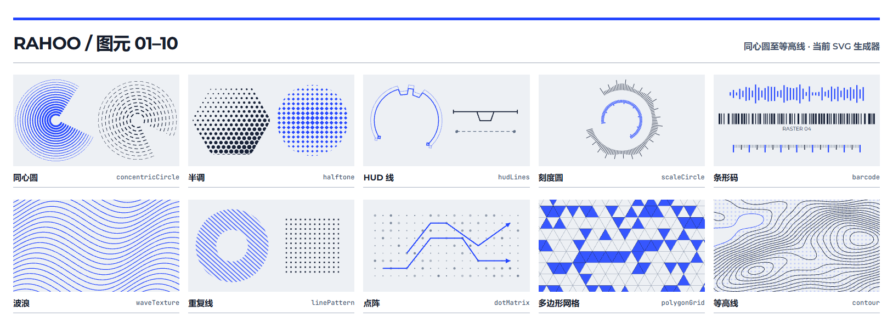
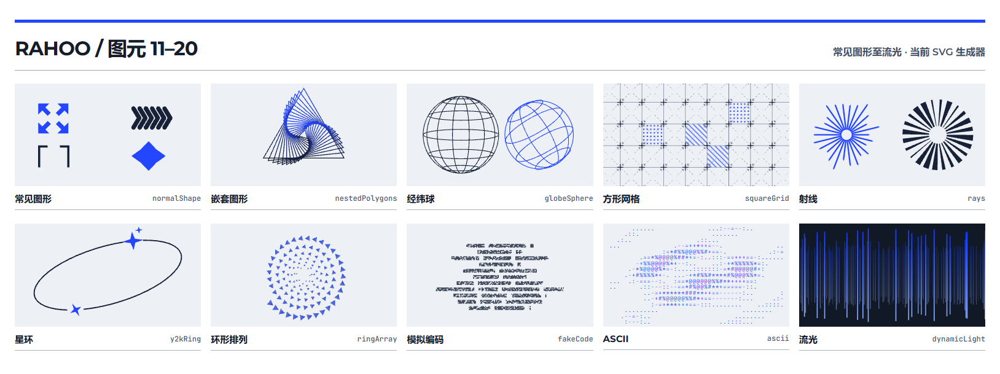
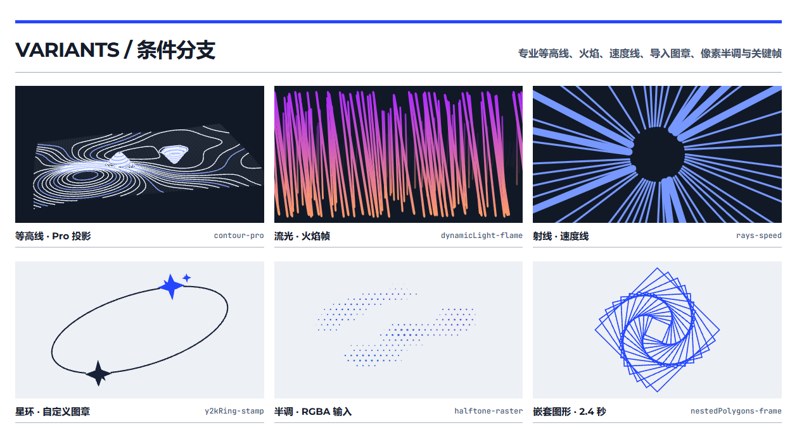
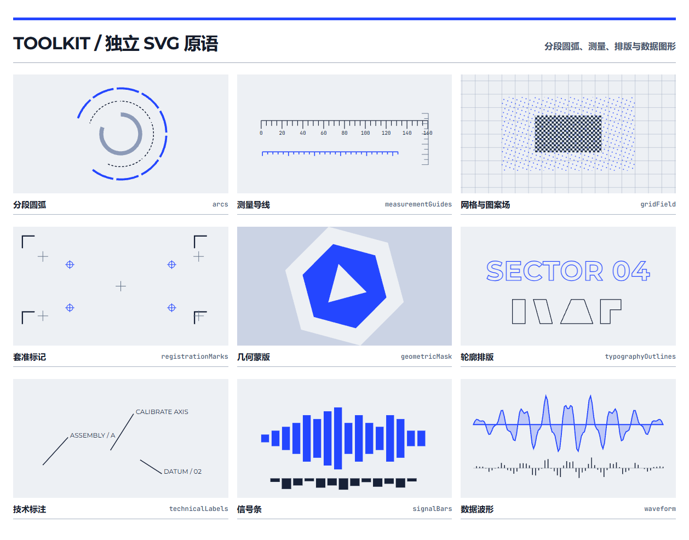

# 图元生成器实现清单

本图册记录 GraphicSpec 的独立 SVG 实现。要生成与官方发布构建一致的图元，请使用 [RahooSpec 原生渲染](rahoo-native.md) 和对应的差分验收命令。

本地内置目录有 **29 种生成器**。其中 **20 种**与 Rahoo 的公开图元一一对应，**9 种**是项目独立 SVG 原语。按下文的标准，**21 种已实现，8 种部分实现**。表中每一项都附有本地生成结果的 Chromium 截图。另有 6 张条件分支截图和 1 张插件扩展示例。

**已实现**表示当前版本可生成该图元的主要图形。**部分实现**表示还有关键参数、算法或输出模式与原站有可辨别的差异。两种状态都以本地代码和运行结果为依据。全参数及逐像素一致性仍需逐项对照。

## 从 rahoo.online 获取的代码

2026-11-22 直接读取网站主页和其发布的脚本，按路由找到设计工具。站点入口 `index-DK0-HGj1.js` 的 `/design-tool` 加载 `index-DmH-F12K.js`。该 JavaScript 文件为 **450,367 字节**，SHA-256 为 `dd80e9b7c827e175fbe6159bd9de3dc7051036fd713e203dfbeb9f2802fd39c6`。其注册表列出的 20 个 ID 与本地图元目录逐项匹配。[Rahoo 站点](https://rahoo.online/) · [站点入口 JavaScript](https://rahoo.online/assets/index-DK0-HGj1.js) · [图元工具 JavaScript](https://rahoo.online/assets/index-DmH-F12K.js)

发布脚本未指定 source map。同名 `.js.map` 地址虽返回 HTTP 200，响应的内容类型和 SHA-256 表明它与主页 HTML 完全相同。本次取得的是可直接阅读的压缩构建，能用于核对注册表、参数和算法分支。开发源文件与源代码复用许可未查到。本地 CLI 的图元当前使用独立实现，网站脚本用于核对。[设计工具页面](https://rahoo.online/design-tool)

Chromium 同时打开了源站同心圆工具，截图保留原站的参数与顶部 20 个标签页。[源站实拍](generator-status/rahoo-source.png)

## Rahoo 对应图元

| 图元 | 实现状态 | 当前实现与证据 | 差异与待验收 |
| --- | --- | --- | --- |
| 同心圆 `concentricCircle` | 已实现 | 圈数、内外半径和描边、角度、实线及虚点线。 [截图](generator-status/concentricCircle.png) | 默认值及 SVG 与 Canvas 的像素输出待逐项比对。 |
| 半调 `halftone` | 部分实现 | 线性或径向梯度、格点与点形、几何遮罩、珠模式、RGBA 取色。 [截图](generator-status/halftone.png) · [RGBA](generator-status/halftone-raster.png) | `strokeAlign` 的内描边和外描边目前均为加宽描边。图像明暗和遮罩采样为本地算法。 |
| HUD 线 `hudLines` | 已实现 | 弧线和直线、双缺口、凹槽、端头、副线及多图层。 [截图](generator-status/hudLines.png) | 缺口圆角、端头和闭合填充的几何使用本地算法。 |
| 刻度圆 `scaleCircle` | 已实现 | 刻度密度、内外对齐、主刻度、波形幅度、抖动和多层组合。 [截图](generator-status/scaleCircle.png) | 抖动由配置种子控制。原站随机分布和默认组合待比对。 |
| 条形码 `barcode` | 部分实现 | 一张图展示三种变体，依次是频谱条、文字驱动条纹、分级标尺。 [截图](generator-status/barcode.png) | 中部为装饰条纹，尚无条码标准的完整编码、校验位及扫码验证。 |
| 波浪 `waveTexture` | 已实现 | 间距、频率、振幅、笔宽、颜色和背景。 [截图](generator-status/waveTexture.png) | 本地以折线采样。细节精度待与源站绘制对照。 |
| 重复线 `linePattern` | 已实现 | 横线、竖线、斜线和点，可使用环形、矩形或图片剪裁。 [截图](generator-status/linePattern.png) | 截图覆盖斜线和点两种模式。 |
| 点阵 `dotMatrix` | 部分实现 | 有限及无限布局、随机尺寸或透明度、编号节点连线和箭头。 [截图](generator-status/dotMatrix.png) | 路径以坐标数组输入。圆角当前以连接样式近似，缺少按指定半径拟合。 |
| 多边形网格 `polygonGrid` | 已实现 | 三角、六边、直角三角和矩形，支持颜色、透明度与选中单元。 [截图](generator-status/polygonGrid.png) | 点击或拖拽的结果以单元坐标提交。描边内外对齐是近似效果。 |
| 等高线 `contour` | 部分实现 | 经典等值线、逐级填充和样式。专业分支提供笔刷操作数据与 SVG 视角投影。 [经典](generator-status/contour.png) · [专业](generator-status/contour-pro.png) | 专业模式的地形构造和相机是本地近似，原站 3D 编辑和投影仍待对照。 |

| 图元 | 实现状态 | 当前实现与证据 | 差异与待验收 |
| --- | --- | --- | --- |
| 常见图形 `normalShape` | 部分实现 | 箭头、斜线、括号、十字和四角星等，截图展示四种组合。 [截图](generator-status/normalShape.png) | 部分分支的几何圆角和精确内外描边待补。 |
| 嵌套图形 `nestedPolygons` | 部分实现 | 多边数、半径递减、旋转步差、渐变及数值关键帧插值。 [截图](generator-status/nestedPolygons.png) · [2.4 秒](generator-status/nestedPolygons-frame.png) | CLI 输出指定时刻的 SVG。时间轴交互与连续动画导出待补。 |
| 经纬球 `globeSphere` | 已实现 | 轴宽高、经纬线密度、纬线倾角和线宽。 [截图](generator-status/globeSphere.png) | 使用二维椭圆和线段构造。 |
| 方形网格 `squareGrid` | 已实现 | 预设、斜线、节点、角标，以及按行列选中点填充或线填充。 [截图](generator-status/squareGrid.png) | 编辑器的圈选结果以 `fills` 中的坐标表示。 |
| 射线 `rays` | 部分实现 | 固定线宽、张角、随机扇片和速度线。 [截图](generator-status/rays.png) · [速度线](generator-status/rays-speed.png) | 张角和随机分支的端头控制不完整。长度、对称与速度线分布待比对。 |
| 星环 `y2kRing` | 已实现 | 椭圆断口、多个星标、卫星、朝向以及自定义 SVG 路径图章。 [截图](generator-status/y2kRing.png) · [自定义](generator-status/y2kRing-stamp.png) | 图章通过路径和宽高传入。断口算法和原站导入交互待对照。 |
| 环形排列 `ringArray` | 已实现 | 形状、环排或螺旋、角度与间距、方向、尺寸、半径变化。 [截图](generator-status/ringArray.png) | 随机半径和渐变为本地实现。 |
| 模拟编码 `fakeCode` | 已实现 | 像素块、词间隔、对齐、透明度分档及确定性种子。 [截图](generator-status/fakeCode.png) | 使用本地随机规则。 |
| ASCII `ascii` | 已实现 | 字符集、字号、密度、亮度、对比度、反相和像素颜色。 [截图](generator-status/ascii.png) | SVG 字符外观随可用字体变化。 |
| 流光 `dynamicLight` | 部分实现 | 流光与火焰两种 SVG 帧，可指定速度、角度、颜色、时间和循环。 [流光](generator-status/dynamicLight.png) · [火焰](generator-status/dynamicLight-flame.png) | 原站的 WebGL 着色器、连续预览和视频导出尚未移植。 |

## 项目独立的 SVG 原语

| 图元 | 实现状态 | 当前实现与证据 |
| --- | --- | --- |
| 分段圆弧 `arcs` | 已实现 | 正负扫角、分段与留缝，可切换实线、虚线或点线。 [截图](generator-status/arcs.png) |
| 测量导线 `measurementGuides` | 已实现 | 横纵标尺、长短刻度、起始值和步进标签。 [截图](generator-status/measurementGuides.png) |
| 网格与图案场 `gridField` | 已实现 | 线网、点网、棋盘格和旋转。 [截图](generator-status/gridField.png) |
| 套准标记 `registrationMarks` | 已实现 | 角标、十字与靶标，可加中心标记。 [截图](generator-status/registrationMarks.png) |
| 几何蒙版 `geometricMask` | 已实现 | 圆、矩形、菱形、六边形或三角形，支持正向和反向裁切。当前裁切该原语自己的填色区域。 [截图](generator-status/geometricMask.png) |
| 轮廓排版 `typographyOutlines` | 已实现 | 文字 SVG 描边、字距与横向伸缩，以及传入字形路径。依赖字体的文字保留为 `<text>`。 [截图](generator-status/typographyOutlines.png) |
| 技术标注 `technicalLabels` | 已实现 | 用显式锚点、偏移、字体和引线标注对象。 [截图](generator-status/technicalLabels.png) |
| 信号条 `signalBars` | 已实现 | 根据数组生成条带，可设定间隙、基线和量化级数。 [截图](generator-status/signalBars.png) |
| 数据波形 `waveform` | 已实现 | 从采样值生成折线、面积或纵线波形，并可配置基线。 [截图](generator-status/waveform.png) |

[扩展示例 orbitWeave](generator-status/orbitWeave.png)通过本地插件生成轨迹组合。源码与输入分别位于 [orbit-weave.mjs](../examples/graphics/orbit-weave.mjs) 和 [orbit-weave.json](../examples/graphics/orbit-weave.json)。

## 验证范围

Chromium 159.0.4402.13 确认 29 个内置图元和 6 个补充变体均可以解析并渲染。每个样例先进行配置校验、重复生成的 SVG 字节比对和 XML 解析，再检测位图是否含有可见图形并截图。图中使用了便于对照的示例参数。截图支持所列分支的本地渲染结果，源站视觉与每个参数的边界行为仍需差分测试。[生成配置](generator-status/examples.json) · [渲染检查](generator-status/checks.json)
